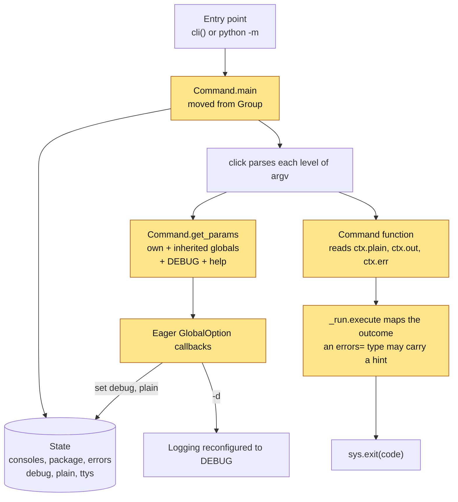
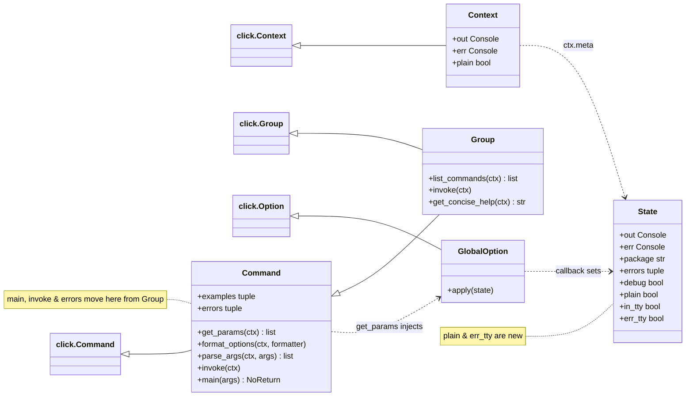
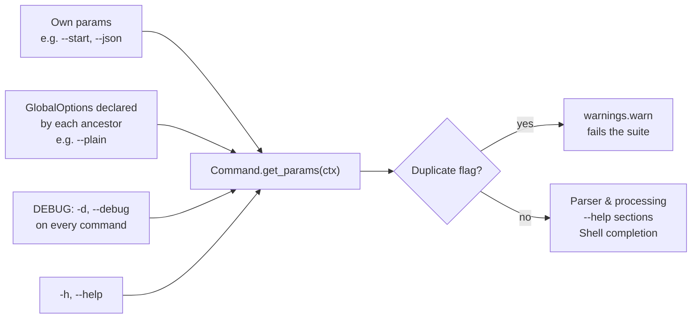
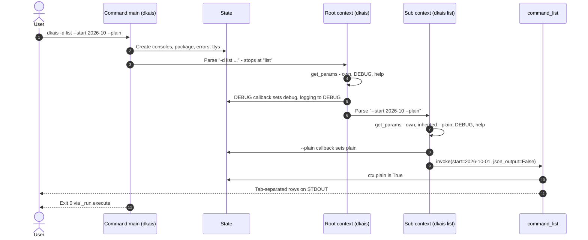
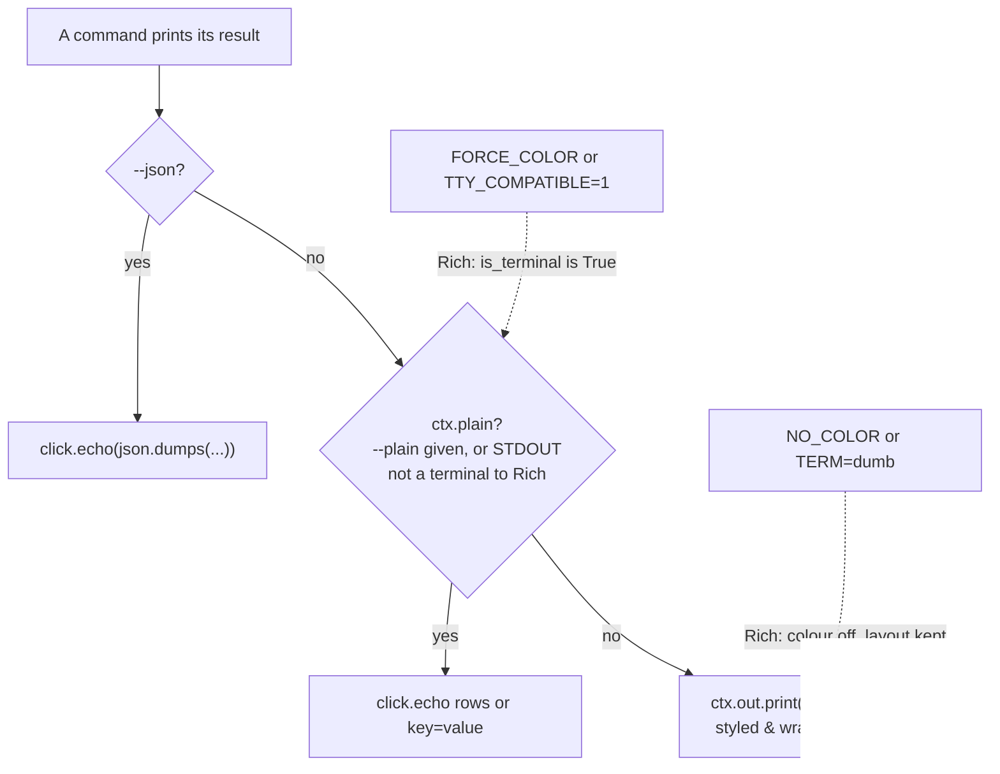
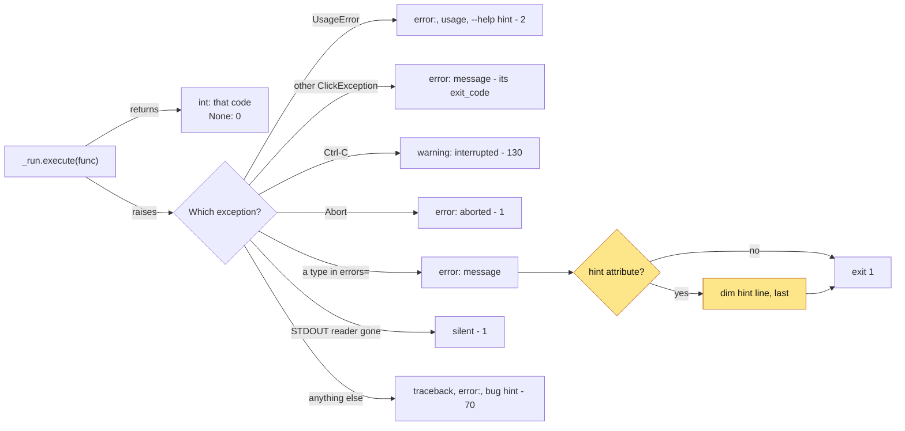
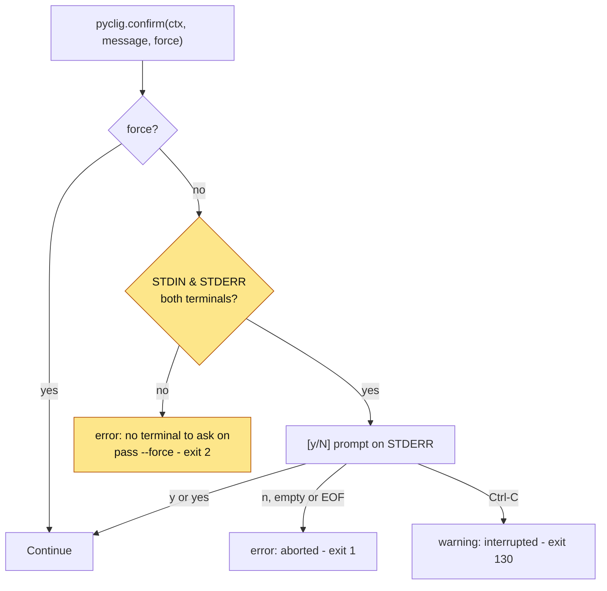
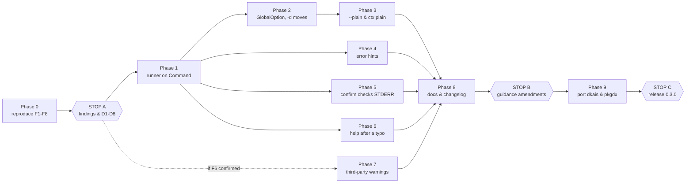

# Plan - pyclig 0.3.0: global options & CLIG gaps

> [!NOTE]
> Superseded in part. 0.3.0 was built from a wider plan - CLIG as an enforceable contract, with
> `docs/clig-coverage.md` as the requirement table and `docs/roadmap.md` for what follows - and its
> verdict on each item here is recorded in `docs/evaluation.md`, round 3. In short: F1-F5, F7 & F8
> confirmed and fixed (F7's sketch had a bug: snapshot the arguments before parsing); F6 confirmed
> and moved to the roadmap; D1 changed to an honest console plus `--plain` (`ctx.format` replaces
> `ctx.plain`); D2 changed to a full `GLOBAL OPTIONS:` section at the root and one line on
> subcommands; D4 extended with `exit_code`; D6 deferred; D7 b & c changed (examples first, concise
> help for commands needing arguments); `_warn_duplicates` dropped (an app's own flag wins); the
> Phase 0 `xfail` commit and Phase 9 consumer ports replaced by scratch-clone integration and
> transition issues. The rest of the document is kept as written.

Date: 3 November 2026. Basis: pyclig `main` at `1376637` (0.2.0), dkais `main` at `3c3861c`,
pkgdx `main` at `6a305d4`.

A working document, like `docs/evaluation.md`, so it carries no frontmatter. It turns a review of
pyclig against [clig.dev](https://clig.dev/) into findings to verify, decisions to take and phased
work. The Mermaid diagrams render on GitHub, and in VS Code with a Mermaid preview extension.

## How to use this plan

For the agent:

1. Read `AGENTS.md`, then `standard-yagni.md`, `standard-cli.md`, `toolchain-pytest.md` &
   `toolchain-logging.md` in `docs/guidance`.
2. Treat every finding as a claim. Reproduce it in Phase 0 before building on it - a refuted
   finding drops its phase.
3. Stop at each gate (STOP A, B & C) and report in the style of `docs/evaluation.md`. Do not
   start the next phase until the user approves.
4. Never edit an `immutable: true` file. Draft amendments in the STOP B report.
5. The sketches show intent. They were checked against click 8.5.0 & Rich 15.0.0 in a throwaway
   prototype (see (3)), not against this repository. Where the real code suggests something
   simpler, propose it at the next gate instead of following the sketch.
6. Work on `feat/global-options`, one commit per phase, with the prefixes already in the history
   (`feat:`, `fix:`, `test:`, `docs:`, `chore:`).

## (1) Summary

pyclig implements the CLIG basics well: streams, exit codes, help, error rendering & Ctrl-C. The
gaps fall into three groups:

- Structural: the runner exists only on `Group`, and `-d` - the one flag accepted before & after
  the command name - is hard-coded in `Command.__init__`
- A missing escape hatch: dkais #10 made `FORCE_COLOR` & `TTY_COMPATIBLE` render piped output as
  on a terminal (for `| less -R`), so a script in an environment exporting them cannot get plain
  rows - CLIG's answer is `--plain`
- Smaller gaps: errors without a hint, `confirm()` with STDERR redirected, `-h` after a typo &
  third-party warnings bypassing the run console

The centrepiece is `GlobalOption`: a run-level flag declared once, injected into every command
below it through `Command.get_params`, and written to the run's `State`. `-d` moves onto it with
no change in behaviour; `--plain` is its first new user.

This revisits round 2's decline of `--plain`. Its reason - 'dkais list already prints
tab-separated rows off a terminal' - no longer holds once `FORCE_COLOR` is exported (e.g. by a CI
job that wants coloured logs), because #10 made that case render as on a terminal.

A run after the change - new or changed parts shaded:



## (2) Findings to verify

| ID | Finding | Phase |
| --- | --- | --- |
| F1 | `click.command(cls=pyclig.Command)` has no runner: `-d` is a no-op, `ctx.out` raises | 1 |
| F2 | No `--plain`: with `FORCE_COLOR` exported, `dkais list \| cut -f1` gets the table | 3 |
| F3 | No mechanism for run-level flags; `-d` is a special case | 2 |
| F4 | `errors=` types carry only a message, so remedies are folded into it | 4 |
| F5 | `confirm()` prompts when STDERR is not a terminal (`2>log` looks like a hang) | 5 |
| F6 | Third-party log warnings & `warnings.warn` bypass the run's STDERR console | 7 |
| F7 | `prog list --strt -h` prints the typo error, not help | 6 |
| F8 | `errors=` on a nested group is silently ignored | 1 |

Evidence gathered so far:

- F1: `_debug` returns when `_state(ctx)` is None, and `State` is only created in `Group.main`;
  `test_click_command_with_pyclig_class_takes_examples` already uses a standalone `Command`
- F2: dkais `command_list` branches on `ctx.out.is_terminal`, and dkais
  `test_forced_colour_styles_piped_summary` shows `FORCE_COLOR=1` makes the piped summary the human
  line - the `key=value` line for scripts is unreachable while the variable is set
- F3: round 2 declined `-q` partly because '`info()` would need the run state'
- F4: pkgdx `ToolNotFoundError` reads '`ruff` not found on PATH - run the hook in the environment
  pkgdx is installed in, e.g. via `uv run`'; `GitNotFoundError` gives no remedy at all
- F5: round 2 'Remaining' lists 'With `2>log`, the confirmation prompt goes to the log'
- F6: a hypothesis - the package logger stops propagating, the root logger has no handler, so
  `logging.lastResort` writes the bare message to `sys.stderr`, outside any live `Progress`
- F7: click raises `NoSuchOption` while parsing, before the eager help callback runs
- F8: the runner reads `self.errors` from the root group only

## (3) Prototype checks

A throwaway model of the design (not pyclig code) on click 8.5.0 & Rich 15.0.0:

| Check | Result |
| --- | --- |
| Global flag before & after the command, nested group, `add_command` | Works via `get_params` |
| Global flag on a standalone command | Works once `main` is on `Command` |
| Shell completion of a subcommand | Offers the inherited flags |
| A command redeclaring a global flag | No click warning - both apply silently |
| `prog list --strt 1 --help` | Typo error; a `parse_args` fallback shows help |
| `prog list --strt 1 -- --help` | Typo error, as it should be |
| `FORCE_COLOR=1`, STDOUT piped | `Console().is_terminal` is True |
| `console.no_color = True` after creation | Colour codes dropped |

The fourth row is why `get_params` sketches its own duplicate check below.

## (4) Decisions for STOP A

- **D1 - `FORCE_COLOR` & plain output.** (a) Keep #10 and add a global `--plain`, with
  `ctx.plain` for commands to branch on. (b) Decouple colour from layout: colour from the
  environment, layout from the real `isatty`. Recommended: (a), because (b) breaks #10's
  acceptance criterion that `FORCE_COLOR=1 dkais list | less -R` renders as on a terminal.
- **D2 - Help for global flags.** A `GLOBAL OPTIONS:` section after `OPTIONS:` on every command,
  like the 'INHERITED FLAGS' of `gh`, or keep them under `OPTIONS:`. Recommended: the section,
  which tells users `-d` works anywhere. It changes the help layout tests.
- **D3 - Standalone commands.** Support them (`pyclig.command()`, runner on `Command`) or reject
  them loudly. Recommended: support - moving `main` adds almost no code and removes a silent
  no-op.
- **D4 - Error hints.** A duck-typed `hint` attribute on `errors=` types, which keeps library
  exceptions free of pyclig imports, or a `pyclig.Error` base class. Recommended: the attribute.
- **D5 - `confirm()`.** Also require a terminal on STDERR. Recommended: yes. A typed confirmation
  (`expect=`) for severe actions such as `dkais download --all` is recommended not now - the
  prompt already shows the size and defaults to No.
- **D6 - Third-party warnings.** Route the root logger & `warnings` through the run's STDERR
  console. Recommended: only if F6 is confirmed and dkais or pkgdx hits it, per the `AGENTS.md`
  rule that a pattern is added when a consuming CLI uses it.
- **D7 - Help details.** (a) `-h` wins after a typo: recommended. (b) Examples before options, as
  CLIG suggests: the user's call, since the current order was approved in round 2. (c) A
  `no_args_is_help` command prints full help on STDERR, exit 2, while a bare group prints concise
  help on STDOUT, exit 0: the user's call - one concise layout for both is possible. (d) A broken
  STDOUT pipe exits 1: recommended to keep, as the `signal` module docs do; under `pipefail`,
  1 & 141 both fail.
- **D8 - Release.** 0.3.0, breaking only in help layout (D2) and `confirm()` (D5). Consumers move
  to `pyclig~=0.3`.

## (5) Design

### (5.1) Global options

Rules:

- Declared on the command whose subtree it covers - normally the root group - through a factory
  in `pyclig.options` that passes `cls=pyclig.GlobalOption`
- Accepted on that command & every command below it, before or after the command name
- Never passed to the command function: an eager callback updates `State`, so it acts as soon as
  it is parsed - `-d` still applies when a later option is invalid
- OR-ed across positions: `-d` anywhere sets `state.debug`
- About how the run behaves (logging, layout, colour, prompting), never what a command does -
  command inputs such as dkais `--data-dir` stay ordinary click options
- Never redeclared by a command: `get_params` warns, which the suite's
  `filterwarnings = ["error"]` turns into a failure

The classes after the change:



Where a command's parameters come from - one list feeds parsing, help & completion:



`dkais -d list --start 2026-10 --plain`, step by step:



Sketch for `src/pyclig/_core.py`, which gains `import warnings` & `collections.Counter`.
`examples`, `format_epilog` & the usage-error binding in `parse_args` stay as they are;
`Command.__init__` no longer appends `-d`:

```python
class GlobalOption(click.Option):
    """A run-level flag, accepted on its command & every command below it.

    NOTE: Never passed to the command function - the eager callback updates
    the run's `State`, so the flag acts as soon as it is parsed.
    """

    def __init__(
        self,
        param_decls: Sequence[str],
        *,
        apply: Callable[[_run.State], None],
        **kwargs: Any,
    ) -> None:
        """Create the option.

        Args:
            param_decls: The flag names, e.g. `["--plain"]`.
            apply: Update the run's state when the flag is given.
            **kwargs: Keyword `click.Option` arguments, e.g. `help`.
        """

        def callback(
            ctx: click.Context, param: click.Parameter, value: bool
        ) -> None:
            state = _state(ctx)
            if value and state is not None and not ctx.resilient_parsing:
                apply(state)

        super().__init__(
            param_decls,
            is_flag=True,
            is_eager=True,
            expose_value=False,
            callback=callback,
            **kwargs,
        )


def _set_debug(state: _run.State) -> None:
    """Switch the run's logging to `DEBUG`, once."""
    if not state.debug:
        state.debug = True
        _logging.configure(state.package, state.err, debug=True)


def _set_plain(state: _run.State) -> None:
    """Ask commands for plain, one-record-per-line STDOUT."""
    state.plain = True


DEBUG = GlobalOption(
    ["-d", "--debug"], apply=_set_debug, help="Show debug logging output."
)


def _inherited(ctx: click.Context) -> list[click.Parameter]:
    """Return the global options declared by the ancestors of `ctx`."""
    found: list[click.Parameter] = []
    parent = ctx.parent
    while parent is not None:
        found += [
            p for p in parent.command.params if isinstance(p, GlobalOption)
        ]
        parent = parent.parent
    return found


def _warn_duplicates(params: list[click.Parameter]) -> None:
    """Warn about a flag declared twice, as click does for its own list."""
    counts = Counter(opt for param in params for opt in param.opts)
    for opt in (opt for opt, n in counts.items() if n > 1):
        warnings.warn(
            f"{opt} is a global option - remove it from the command",
            stacklevel=3,
        )


class Command(click.Command):
    """A click command with global options & the pyclig help layout."""

    def get_params(self, ctx: click.Context) -> list[click.Parameter]:
        """Return own params, inherited global options, `-d` & help.

        Args:
            ctx: The command's context.

        Returns:
            The parameters, in parsing & help order.
        """
        help_option = self.get_help_option(ctx)
        own = [p for p in super().get_params(ctx) if p is not help_option]
        tail = [help_option] if help_option is not None else []
        params = [*own, *_inherited(ctx), DEBUG, *tail]
        _warn_duplicates(params)
        return params

    def format_options(
        self, ctx: click.Context, formatter: click.HelpFormatter
    ) -> None:
        """Write `OPTIONS:`, then `GLOBAL OPTIONS:`.

        Args:
            ctx: The command's context.
            formatter: The help formatter.
        """
        local: list[tuple[str, str]] = []
        inherited: list[tuple[str, str]] = []
        for param in self.get_params(ctx):
            record = param.get_help_record(ctx)
            if record is None or isinstance(param, click.Argument):
                continue
            is_global = isinstance(param, GlobalOption)
            (inherited if is_global else local).append(record)
        for heading, records in (
            ("Options", local),
            ("Global options", inherited),
        ):
            if records:
                with formatter.section(heading):
                    formatter.write_dl(records)


class Group(Command, click.Group):
    """A click group running the CLIG conventions."""

    def format_options(
        self, ctx: click.Context, formatter: click.HelpFormatter
    ) -> None:
        """Write the options as a `Command` does, then the commands.

        Args:
            ctx: The group's context.
            formatter: The help formatter.
        """
        Command.format_options(self, ctx, formatter)
        self.format_commands(ctx, formatter)
```

`DEBUG` is one shared instance: click keeps values in `ctx.params`, not on the parameter, and
`-d` is never exposed. `GlobalOption` is exported from `pyclig`; `DEBUG` is not.

### (5.2) Plain output (D1 a)

What a command prints, and what decides it:



Sketch:

```python
# src/pyclig/_core.py - on Context
@property
def plain(self) -> bool:
    """Whether STDOUT gets plain, one-record-per-line output.

    NOTE: True with `--plain`, or when STDOUT is not a terminal as Rich
    sees it - `FORCE_COLOR` & `TTY_COMPATIBLE` still render as on a
    terminal (dkais #10), and `--plain` is a script's override.
    """
    state = _require_state(self)
    return state.plain or not state.out.is_terminal


# src/pyclig/options.py - imports GlobalOption & _set_plain from _core
def plain(
    *,
    help: str = "Print plain, one-record-per-line output.",  # noqa: A002
) -> Callable[[FC], FC]:
    """Add the global `--plain`, read by commands as `ctx.plain`.

    Args:
        help: The flag's help text.

    Returns:
        The option decorator - put it on the group.
    """
    return click.option(
        "--plain", cls=GlobalOption, apply=_set_plain, help=help
    )
```

dkais, in Phase 9:

```diff
 @pyclig.group("dkais", ...)
+@pyclig.options.plain()
 def cli() -> None:

-    if not ctx.out.is_terminal:
+    if ctx.plain:

         out=ctx.out,
         err=ctx.err,
+        plain=ctx.plain,
```

`_report.summarise` then branches on `plain` instead of `out.is_terminal`. `--plain` changes
STDOUT only: notices & `-d` records keep following STDERR.

### (5.3) Runner on `Command` (D3, F8)

- Move `Group.main` to `Command`, unchanged. `main` is only called on the root, so subcommands
  never build a second `State`.
- Move the Ctrl-C, `EOFError` & pipe translation from `Group.invoke` to `Command.invoke`.
  `super().invoke` resolves to `click.Group.invoke` on a group and `click.Command.invoke` on a
  command, so one translation covers both, and a translated error passes outer levels untouched.
- Keep only the concise help for a bare invocation in `Group.invoke`.
- Move `errors` to `Command`. `Group.add_command` raises `TypeError` for a subcommand that sets
  `errors=`, which also covers `@cli.group(errors=...)`.
- Add `pyclig.command()`, mirroring `pyclig.group()` with `-v/--version`.
- Let `pyclig.testing.invoke` accept any `pyclig.Command`.
- Reword the no-state `RuntimeError` (round 2 'Remaining') to name a run started by a pyclig
  command's `main()`, and the `pass_context` `TypeError` to name `pyclig.Command`.

```python
class Command(click.Command):
    def invoke(self, ctx: click.Context) -> Any:
        """Invoke the command, carrying Ctrl-C, EOF & pipe errors past click.

        Args:
            ctx: The command's context.

        Returns:
            The command's return value.

        Raises:
            Interrupted: On Ctrl-C.
            Escaped: Carrying an `EOFError` or a pipe `OSError`.
        """
        try:
            return super().invoke(ctx)
        except KeyboardInterrupt as error:
            raise _run.Interrupted from error
        except EOFError as error:
            raise _run.Escaped(error) from error
        except OSError as error:
            if error.errno in _run.PIPE_ERRNOS:
                raise _run.Escaped(error) from error
            raise
```

### (5.4) Error hints (D4)



```python
# src/pyclig/_run.py - in _failed, for a type in `errors=`
message = str(error).strip() or type(error).__name__
notice(state.err, level="error", message=message)
if hint := getattr(error, "hint", None):
    info(state.err, message=str(hint))
return ExitCode.FAILURE
```

pkgdx, in Phase 9 - a class attribute, so no `__init__` changes:

```python
class Error(Exception):
    """Base-class for all exceptions raised by `pkgdx`."""

    hint: str | None = None


class ToolNotFoundError(Error):
    """Raised when a hook tool executable is not found on `PATH`."""

    hint = (
        "Run the hook in the environment pkgdx is installed in, e.g. `uv run`."
    )
```

```text
error: `ruff` not found on PATH
Run the hook in the environment pkgdx is installed in, e.g. `uv run`.
```

CLIG puts the most important information last - the hint is what the user acts on.

### (5.5) `confirm()` (D5)



```python
# src/pyclig/_core.py - in confirm, after the `force` check
state = _require_state(ctx)
if not (state.in_tty and state.err_tty):
    raise click.UsageError(
        "confirmation needed, but there is no terminal to ask on - "
        "pass `--force` to proceed",
        ctx=ctx,
    )
```

`State.err_tty` is the real `isatty` of STDERR, set in `main` like `in_tty`, not
`state.err.is_terminal`: `FORCE_COLOR` makes the console claim a terminal while `2>log` still
hides the prompt. `testing.invoke` passes `pyclig_err_tty=err_tty` next to `pyclig_in_tty`.

### (5.6) Help after a typo (D7 a)

```python
class Command(click.Command):
    def parse_args(self, ctx: click.Context, args: list[str]) -> list[str]:
        """Parse the arguments; a help flag wins over an unknown option."""
        try:
            return super().parse_args(ctx, args)
        except click.UsageError as error:
            if error.ctx is None:
                error.ctx = ctx
            unknown = isinstance(error, click.NoSuchOption)
            if unknown and _asks_for_help(ctx, args):
                click.echo(ctx.get_help(), color=ctx.color)
                ctx.exit()
            raise


def _asks_for_help(ctx: click.Context, args: list[str]) -> bool:
    """Check whether a help flag appears before any `--`."""
    head = args[: args.index("--")] if "--" in args else args
    names = set(ctx.help_option_names)
    return not ctx.resilient_parsing and bool(names.intersection(head))
```

`ctx.exit()` raises click's `Exit`, which `click.Command.main` turns into a return value with
`standalone_mode=False`, so `_run.execute` maps it to 0 - the path `--help` takes today.

### (5.7) Third-party warnings (D6, only if F6 is confirmed)

- `_logging.configure` also attaches the run's handler to the root logger at `WARNING`, and calls
  `logging.captureWarnings(True)`, so `warnings.warn` reaches it through `py.warnings`.
- `_logging.scoped` saves & restores the root logger's handlers and turns capture off again.
- The package logger keeps `propagate = False`, so nothing prints twice. `-d` does not lower the
  root level, so third-party `DEBUG` stays hidden.

## (6) Phases



Every phase is done when:

- `uv run pytest -v` passes, with that phase's `xfail` markers removed
- `just coverage` reports at least 90%
- `uv run mypy --config-file mypy.ini --python-version 3.11` & `--python-version 3.14` are clean
- `uv run prek run --all-files` passes, this plan included

### Phase 0 - reproduce the findings

No source changes. Add each test below in its final form, marked
`@pytest.mark.xfail(strict=True, reason="F<n>")`, with any sample commands it needs (`rows`,
`thirdparty`) in `tests/sample_cli.py`. Each must XFAIL for the reason in the table - read the
failure, not just the outcome. `strict=True` turns a fixed finding into a failure until its
marker is removed.

| ID | Test | Fails on `main` because |
| --- | --- | --- |
| F1 | `test_standalone_command_debug_logs` | `-d` finds no `State` |
| F1 | `test_standalone_command_has_consoles` | `ctx.out` raises `RuntimeError` |
| F2 | `test_plain_flag_prints_rows_on_a_terminal` | No such option `--plain` |
| F2 | `test_plain_flag_overrides_forced_colour` | No such option `--plain` |
| F4 | `test_mapped_error_prints_hint_last` | `hint` is ignored |
| F5 | `test_confirm_fails_without_terminal_stderr` | Prompts & proceeds, exit 0 |
| F6 | `test_third_party_warning_renders_as_notice` | Bare line via `lastResort` |
| F6 | `test_python_warning_renders_as_notice` | `warnings` format, not `warning:` |
| F7 | `test_help_after_unknown_option_shows_help` | `No such option`, exit 2 |
| F8 | `test_nested_group_errors_rejected` | Accepted; the error exits 70 |

Notes:

- F1 tests run through `CliRunner` until Phase 1 widens `invoke`.
- `invoke(out_tty=True)` stands in for `FORCE_COLOR`, because `invoke` sets the terminal flag
  explicitly. `test_plain_flag_overrides_forced_colour` is a subprocess test with
  `FORCE_COLOR=1`, for the real variable.
- F6 tests need a subprocess, since pytest's `log_cli` adds root handlers in-process. Also run
  dkais `process` & `download` and pkgdx `init` once with `-d`, noting any third-party warning -
  none means F6 is confirmed but has no consumer, so Phase 7 is skipped.
- F3 has no test: it is the design gap behind F2.

Commit: `test: reproduce round 3 findings (xfail)`.

**STOP A.** Report a table of findings (Confirmed, Partly, Refuted - with evidence) and ask for
D1-D8.

### Phase 1 - runner on `Command`

Apply (5.3). The F1 & F8 markers come off; add `test_command_decorator_adds_version` for
`pyclig.command()`. Existing runner tests pass unchanged - they run through a group - apart from
the reworded errors in `test_consoles_require_a_run` & `test_pass_context_requires_pyclig_command`.

### Phase 2 - global options

Apply (5.1). Behaviour is unchanged apart from the help layout (D2):

- Pass unchanged: `test_debug_before_or_after_command`, `test_debug_after_invalid_option`,
  `test_debug_absent_logs_warnings_only`, `test_debug_listed_in_command_help`,
  `test_bare_invocation_with_debug_prints_concise_help`
- Update for `GLOBAL OPTIONS:`: `test_full_help_layout`,
  `test_command_help_lists_examples_before_epilog`, `test_command_help_without_examples`
- New, with a test-only `GlobalOption` in `sample_cli.py`:
  `test_global_option_before_or_after_command` (parametrized like the `-d` test),
  `test_global_option_reaches_added_command`, `test_global_option_offered_by_completion`,
  `test_global_option_redeclared_warns`

### Phase 3 - `--plain`

Apply (5.2): `State.plain`, `Context.plain`, `pyclig.options.plain()`. The F2 markers come off;
add `test_plain_false_on_a_terminal_without_flag`.

### Phase 4 - error hints

Apply (5.4). The F4 marker comes off; add `test_mapped_error_without_hint_unchanged`, and a
terminal variant asserting the hint is dim.

### Phase 5 - `confirm()` needs both terminals

Apply (5.5). The F5 marker comes off. Update `CONFIRM_ERROR` and assert the old wording is absent
as well as the new one present (`toolchain-pytest.md`).

### Phase 6 - help after a typo

Apply (5.6). The F7 marker comes off; add `test_unknown_option_after_double_dash_still_errors`.

### Phase 7 - third-party warnings (conditional)

Apply (5.7) only if D6 is approved. The F6 markers come off; extend
`test_logger_restored_after_runs` to the root logger & warning capture.

### Phase 8 - docs & changelog

- `README.md`: 'What every command gets' (was 'What every group gets'), a scope column & `plain()`
  in the standard flags table, `ctx.plain` under Output, `hint` under Errors, the STDERR row in
  the Confirmation table, and `pyclig.command()` & `GlobalOption` usage
- `CHANGELOG.md` `[Unreleased]`: Added (`GlobalOption`, `options.plain()`, `ctx.plain`,
  `pyclig.command()`, `hint`), Changed (`GLOBAL OPTIONS:`, runner on `Command`, `confirm()` needs
  a terminal on STDERR), Fixed (`-d` on standalone commands, `-h` after a typo)
- `docs/evaluation.md`: a 'Round 3' section in the format of rounds 1 & 2

**STOP B.** Propose, without applying, amendments to the immutable guidance - these come from
the copier template, so an approved change is made there first:

- `standard-cli.md`: `--plain` marked (pyclig) with `ctx.plain`; global flags work before or after
  the command; `-h` wins anywhere - MINOR
- `toolchain-logging.md`: (2) still says `-d` prints through a `RichHandler`, but since 0.2.0 it
  is plain lines off a terminal; root logger & warnings if Phase 7 ships - MINOR
- `toolchain-pytest.md`: `invoke` takes any `pyclig.Command` - PATCH

### Phase 9 - consumers

- dkais: `@pyclig.options.plain()` on the group; `ctx.plain` in `command_list` & `summarise`;
  `test_list_rows_with_plain_on_a_terminal` & `test_plain_overrides_forced_colour_summary`;
  #10's tests pass unchanged; `confirm()` message assertions updated
- pkgdx: `hint` on `ToolNotFoundError` & `GitNotFoundError`, with their messages shortened; tests
  assert the hint line and the absence of the old combined message
- An editable path source for pyclig while porting, then `pyclig~=0.3` from PyPI before
  merging, as in round 1

**STOP C.** Report each suite, and the round 1 start-up timings (`dkais --help`, `dkais -v`,
`-X importtime`) - global options must not add imports to the fast paths. Then release 0.3.0.

## (7) Not built

- `-q/--quiet`, `--no-color` & `--no-input`: each becomes a short `GlobalOption` factory once a
  consumer needs it - `--no-color` would set `no_color` on both consoles; Rich already honours
  `NO_COLOR` & `TERM=dumb`
- `exit_code` on `errors=` types: no consumer needs a code other than 1
- A guarded `pyclig.prompt()`: dkais has one prompt, covered by `confirm()`
- SIGTERM handling: revisit if a consumer runs as a container job - map it like Ctrl-C, exit 143
- `<PROG>_DEBUG` for `-d`, configuration files & XDG paths, secrets from files: outside pyclig's
  scope today, which the README should say
